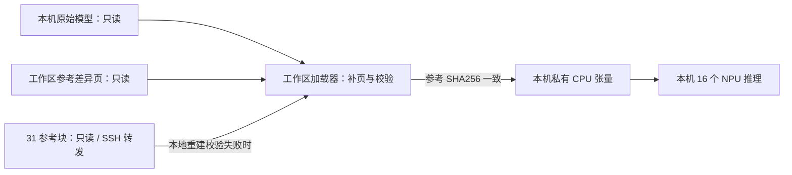

# 模型权重的只读外挂加载

本目录替换的是加载接口。原始模型目录、模型配置和公共镜像均不改写。

## 读取过程

1. 校验工作区 `manifest.json` 的 SHA256、原文件大小/mtime 和张量布局。
2. 从本机原始文件只读读取 32 MiB 数据块，用工作区保存的参考差异页重建。
3. 校验重建块是否与参考 SHA256 一致；不一致时，经 SSH 转发从 31 的只读参考服务取得完整块，再校验长度与 SHA256。
4. 由通过校验的字节组装本进程私有 CPU 张量，交给原有 SGLang / ModelSlim 加载流程。

返回张量包含参考副本的原样字节，没有将 NaN 改成零，也没有重新量化。调用方对私有 CPU 张量的操作不会写回原文件或缓存的参考数据块。



## 文件

- `sitecustomize.py`：由显式环境变量启用；初始化失败时终止进程。
- `external_weight_source.py`：替换目标目录的 `safetensors.safe_open`，支持 `get_tensor` / `get_slice`。
- `verify_payloads.py`：启动前校验清单和全部参考差异页。
- `external_weight_source_before_compact.py`：中断前方案的存档，当前不使用。

`WEIGHT_SOURCE=1` 激活；默认的底层 `serve.sh` 仍支持原生加载。当前人工流程使用 [serve_verified.sh](../../serve_verified.sh)，它会先检查参考读取服务，再启动外挂加载。

## 启动和检查

在 23 操作，两台各自独立单机推理。原实验容器已停止、端口空闲时：

```bash
bash /home/chengyetai/workspace/current_exp/chunk_manual_20260927/serve_verified.sh start 23 8192
bash /home/chengyetai/workspace/current_exp/chunk_manual_20260927/serve_verified.sh start 25 8192
```

状态与日志同步：

```bash
bash /home/chengyetai/workspace/current_exp/chunk_manual_20260927/serve_verified.sh status 23
bash /home/chengyetai/workspace/current_exp/chunk_manual_20260927/serve_verified.sh sync 25 <run_id>
```

加载器只在加载阶段读取 31 的参考块；Prefill/Decode 计算仍在各自本机 NPU 上。参考服务监听 31 的回环地址 `127.0.0.1:30121`，23/25 经 SSH 转发到各自的 `127.0.0.1:30122`。参考服务和脚本都放在 `current_exp` 下，31 不因此占用 NPU。

模型加载缓存上限为每进程 512 块，最多 16 GiB，适用于这两台 2 TiB RAM 主机。该缓存用于启动时的权重读取与校验；实验的前缀 KV 缓存继续由 SGLang 管理，其命中率在负载阶段记录。

原始数据块读出摘要发生变化时，加载器会记录变化，并以最终参考 SHA256 决定是否接收数据；参考服务自身也验证文件身份、长度及摘要。摘要不一致、参考服务不可用或数据不完整时，加载失败。

本轮结果和真实回复：[修复记录](../../semantic_debug_20260927/readonly_resume/README.md)。
